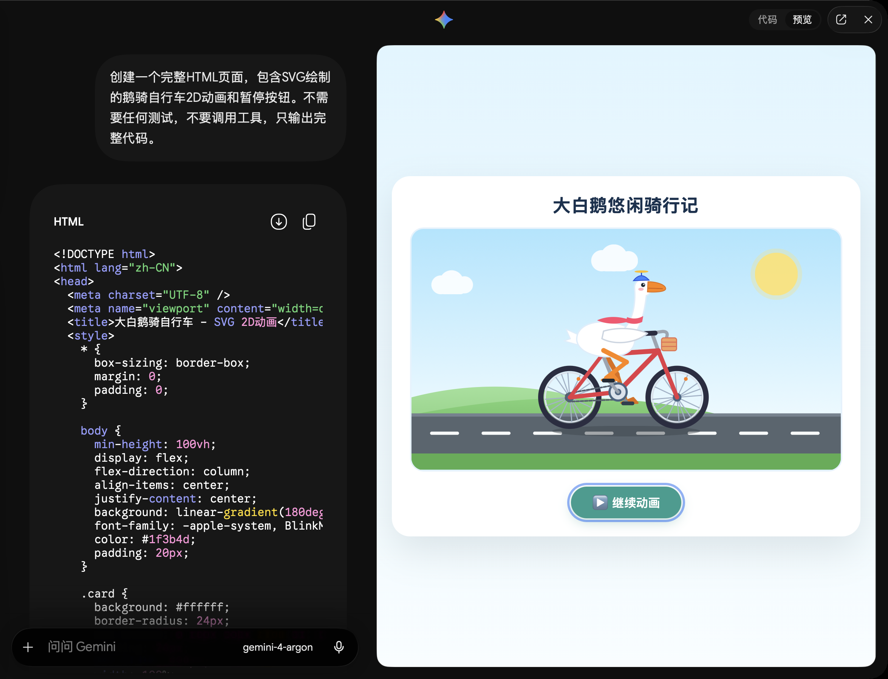
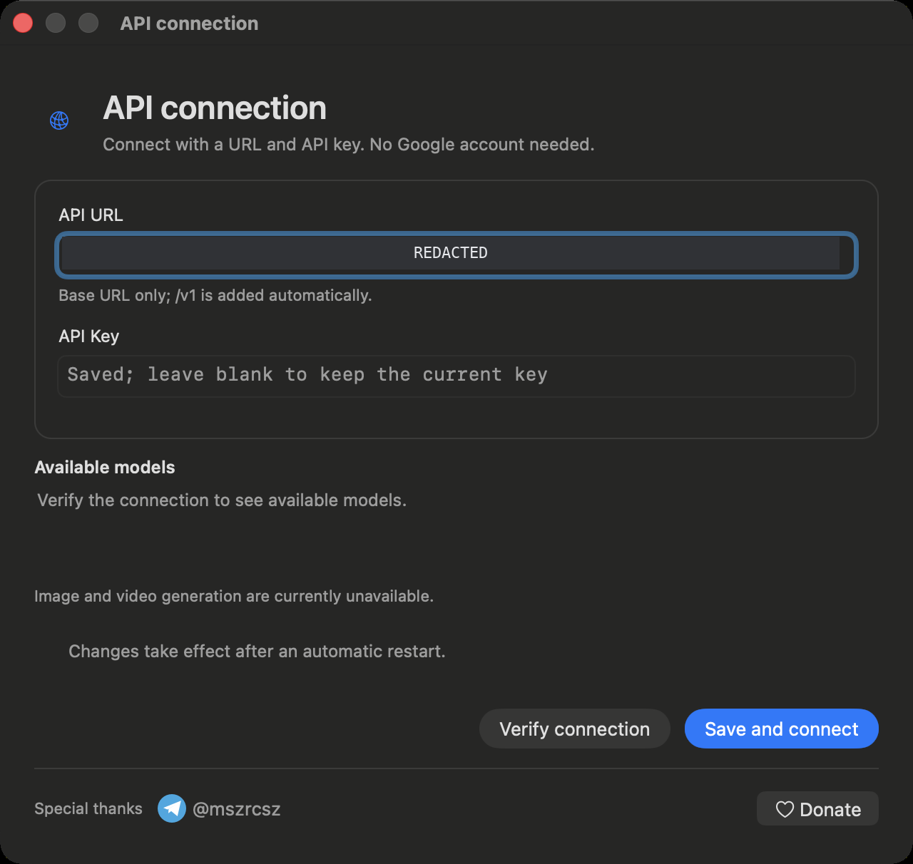
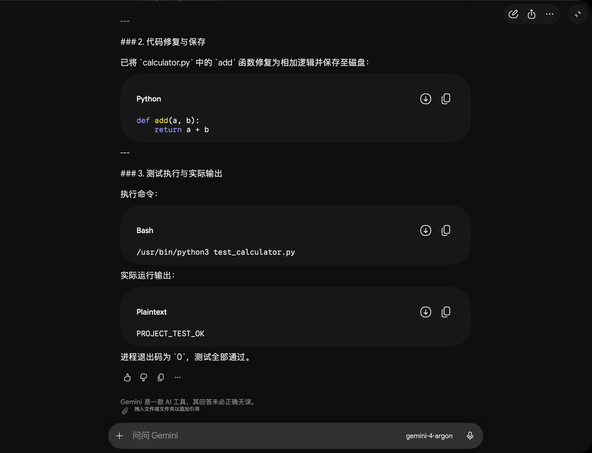

# Gemini Relay · API Relay for the Original Gemini macOS App

**First community release: connect with your own API URL and key, without a Google account, using the original macOS client interface for chat and basic project coding.**

[简体中文](README.md) · English

[](https://t.me/mszrcsz)
[](https://nowpayments.io/embeds/donation-widget?api_key=0a09a5b0-4590-4b3f-a3cf-c4fa08d67ada)

[**Download for macOS**](https://github.com/TGmszrcsz/gemini-relay/releases/tag/v2026.10.15) · [Release notes](docs/RELEASE-v2026.10.15.md) · [Installation guide](docs/INSTALL.md)

Built on the official Gemini macOS app, this community modification adds API relay support and AppKit coding features. This is the first public release of this project. Connect with your own API URL and key, without a Google account. This project is independent of Google and is not an official Google distribution.



## Features

| Feature | This build |
| --- | --- |
| API connection | Enter your URL and key, verify available models, then select a model in chat |
| Chat | Streamed text, activity and elapsed time, local history and persistent deletion |
| Projects | Create or open actual project folders from chat; drop files and folders as references |
| Coding | Read project files, edit code, run commands and tests, and discuss the results |
| Code window | File tree, UTF-8 editing and saving, automatic disk refresh, unsaved edit conflict handling |
| Preview | HTML/SVG code content and interactive HTML previews |
| MCP | Local stdio, remote Streamable HTTP, tool discovery and tool calls |
| Language | Added interfaces follow the system language, with text in 10 languages |

This build focuses on basic Vibe Coding and does not claim full feature parity with Codex or Claude Code.

## Download and install

| Item | Requirement |
| --- | --- |
| Chip | Apple Silicon / arm64 (M-series Mac) |
| System | macOS 15 or later |
| Installer | `Gemini-Relay-2026.10.15-arm64.dmg`, approximately 211 MiB |
| Runtime | Chat needs no Node.js; local MCP servers may require their own runtime |
| Signing | Ad-hoc signed; no Apple Developer ID signature or notarization |

1. Download the DMG from [Releases](https://github.com/TGmszrcsz/gemini-relay/releases/tag/v2026.10.15).
2. Open it and drag `Gemini.app` into `Applications`. Quit and back up any existing app with the same name before replacing it.
3. Launch the app from Applications and enter your own API details.
4. If macOS blocks it, verify the download source, then use System Settings → Privacy & Security → Open Anyway.

Installer SHA-256:

```text
b64b6d8bb1230c19b015a13009dfeb252cf163340137d2b2513f9a89f44aeeb1
```

## Connect your API

On first use, the URL and key are empty. Enter your details, choose **Verify connection** to view the provider's models, then **Save and connect**. Use **Switch API** in the menu to change providers later.

The provider must support Gemini's native generation endpoint `/v1beta/models/...:streamGenerateContent` and the `/v1/models` model list endpoint. A service offering only OpenAI Chat Completions is insufficient. Model names, quotas and billing are determined by the provider.



## Code in a project

Use the project button in the chat area to create or open a folder. Open the code window using the adjacent code button or **Project code** in the menu. Ask the model to inspect or change your code and run a command or test.

You can also edit and save files yourself. The editor refreshes when the model or another editor changes files on disk. Unsaved changes are preserved and a conflict is shown when needed.



## Connect MCP

Open **MCP connections** in the menu, enter standard `mcpServers` JSON, then save and connect to inspect discovered tools. Replace these placeholders with your actual server configuration:

```json
{
  "mcpServers": {
    "local-example": {
      "command": "node",
      "args": ["/path/to/your/mcp-server.js"]
    },
    "remote-example": {
      "url": "https://mcp.example.com/mcp",
      "headers": {
        "Authorization": "Bearer YOUR_MCP_TOKEN"
      }
    }
  }
}
```

Protocol tests passed for stdio and Streamable HTTP, including initialization, tool discovery and calls. Full end-to-end verification of a real model invoking MCP has not been completed. Results also depend on the model and server.

## Current limitations

- Image and video generation are unavailable.
- Intel Macs are unsupported.
- The code editor handles UTF-8 text files up to 2 MB.
- Project commands have an approximately 50-second limit; there is no persistent interactive terminal.
- MCP OAuth, legacy standalone SSE transport and browsing prompts/resources are not implemented.

## Privacy and distribution

The installer contains none of the packager's API URLs, keys, conversations, project paths, MCP settings or Keychain data. Each user supplies their own connection details. Personal configuration and history stay in `~/Library/Application Support/GeminiRelay/` on that user's Mac; upgrading does not automatically erase existing data. Your selected API provider receives content and project files sent to the model.

Screenshots are from the actual app, with personal provider addresses, history lists and local paths removed by opaque redaction or cropping. Image metadata was removed. Screenshots may show different test stages; available models depend on your provider.

This repository distributes the installer, documentation and sanitized screenshots. It does not include the full source of the upstream Gemini client. Gemini and related trademarks belong to their respective owners.

## Special thanks and donations

Special thanks to **Telegram [@mszrcsz](https://t.me/mszrcsz)**.

[](https://t.me/mszrcsz)
[](https://nowpayments.io/embeds/donation-widget?api_key=0a09a5b0-4590-4b3f-a3cf-c4fa08d67ada)

The donation button opens the public NOWPayments donation page. Thank you for your support.
