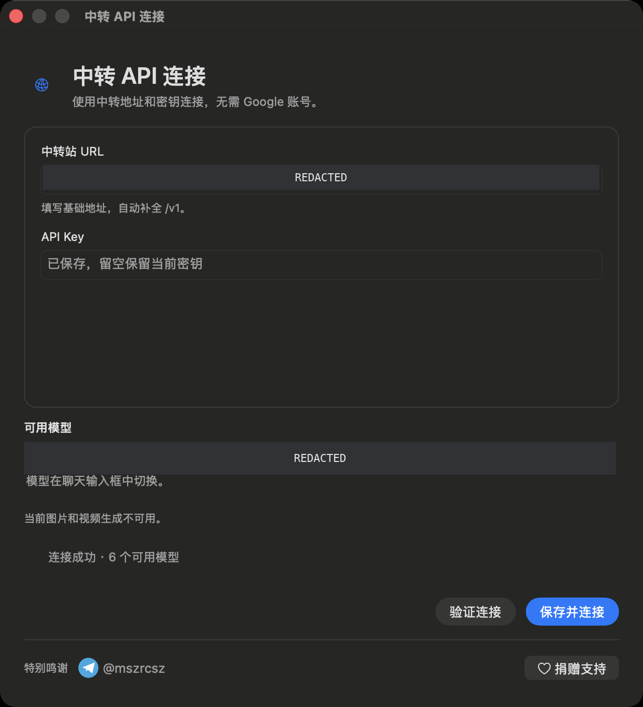

# Gemini Relay

**面向 macOS 的第三方 API 客户端：聊天、项目编程、HTML 预览与 MCP。**

简体中文 · [English](README.en.md)

[](https://t.me/mszrcsz)
[](https://nowpayments.io/embeds/donation-widget?api_key=0a09a5b0-4590-4b3f-a3cf-c4fa08d67ada)

[**下载 macOS 安装包**](https://github.com/TGmszrcsz/gemini-relay/releases/tag/v2026.10.15) · [发布说明](docs/RELEASE-v2026.10.15.md) · [安装指南](docs/INSTALL.md)

这是在 Gemini macOS 原有客户端上加入第三方 API 适配和 AppKit 编程功能的修改版本。使用自己的 API URL 和 API Key 即可连接，无需 Google 账号。本项目独立于 Google，不是 Google 官方发行版。


## 能做什么

| 功能 | 当前版本 |
| --- | --- |
| API 连接 | 填写自己的地址与密钥，验证连接后显示可用模型，在对话中切换模型 |
| 日常对话 | 流式文字、执行状态与耗时、本地历史记录、持久删除 |
| 项目 | 在对话区域创建或打开真实项目目录，拖入文件及文件夹作为引用 |
| 编程 | 读取项目文件、修改代码、运行命令和测试，并继续讨论结果 |
| 代码窗口 | 文件树、UTF-8 文本编辑与保存、磁盘变化自动刷新、未保存内容冲突提示 |
| 预览 | HTML/SVG 代码内容与交互式 HTML 预览 |
| MCP | 本地 stdio、远程 Streamable HTTP、工具发现与调用 |
| 语言 | 新增界面跟随系统语言，提供中英文等 10 种语言文案 |

本版本面向基础 Vibe Coding，不宣称完整复现 Codex 或 Claude Code 的所有功能。

## 下载与安装

| 项目 | 要求 |
| --- | --- |
| 芯片 | Apple Silicon / arm64（M 系列 Mac） |
| 系统 | macOS 15 或更新版本 |
| 安装包 | `Gemini-Relay-2026.10.15-arm64.dmg`，约 211 MiB |
| 运行环境 | 普通聊天无需 Node.js；所连接的本地 MCP 服务可能需要自行安装对应环境 |
| 签名 | 本地临时签名（ad-hoc），无 Apple Developer ID 签名或公证 |

1. 从 [Releases](https://github.com/TGmszrcsz/gemini-relay/releases/tag/v2026.10.15) 下载 DMG。
2. 打开 DMG，将 `Gemini.app` 拖到 `Applications`。如已安装同名应用，请先退出并备份旧版。
3. 从“应用程序”启动，填写自己的 API 信息。
4. 如被 macOS 阻止，在确认下载来源后前往“系统设置 → 隐私与安全性”选择“仍要打开”。

安装包 SHA-256：

```text
b64b6d8bb1230c19b015a13009dfeb252cf163340137d2b2513f9a89f44aeeb1
```

## 连接自己的 API

首次使用时，API URL 和 API Key 为空。填写自己的信息，点击“验证连接”查看服务商返回的模型，再点击“保存并连接”。以后可从菜单的“切换 API”重新配置。

服务需支持 Gemini 原生生成接口 `/v1beta/models/...:streamGenerateContent` 和模型列表接口 `/v1/models`。仅支持 OpenAI Chat Completions 的服务不能直接使用；具体模型名称、额度和计费由服务商决定。



## 在对话中编程

点击对话区域的项目按钮，创建或打开项目；通过项目旁的代码按钮或菜单“项目代码”查看文件。把需求发到对话中，模型可以读取、修改项目代码，并运行命令或测试。

可以直接编辑代码窗口中的文件并保存。模型或外部编辑器修改文件后，窗口会自动刷新；若当前有未保存的修改，会保留内容并提示冲突。


## 连接 MCP

打开菜单“MCP 连接”，填写标准 `mcpServers` JSON，保存并连接后查看工具列表。下面是格式示例，需替换为实际服务配置：

```json
{
  "mcpServers": {
    "local-example": {
      "command": "node",
      "args": ["/path/to/your/mcp-server.js"]
    },
    "remote-example": {
      "url": "https://mcp.example.com/mcp",
      "headers": {
        "Authorization": "Bearer YOUR_MCP_TOKEN"
      }
    }
  }
}
```

stdio 和 Streamable HTTP 的协议测试已通过，包括初始化、工具发现与工具调用。实际模型触发 MCP 的完整端到端验证尚未完成，效果也取决于模型及服务端支持。

## 当前限制

- 图片和视频生成不可用。
- 暂不支持 Intel Mac。
- 代码编辑器支持最大 2 MB 的 UTF-8 文本。
- 单次项目命令最长约 50 秒，暂不提供长期运行的交互式终端。
- MCP 暂不支持 OAuth 登录、旧版独立 SSE 传输，以及 prompts/resources 浏览。

## 隐私与发布内容

安装包不包含打包者的 API URL、API Key、对话、项目路径、MCP 配置或钥匙串数据。首次连接由每位使用者自行填写。个人配置与对话保存在自己电脑的 `~/Library/Application Support/GeminiRelay/`；升级不会自动清空已有数据。所选服务商会收到发送给模型的内容和使用到的项目文件。

本页截图来自实际应用，已用不透明遮盖或裁切隐藏个人服务地址、历史列表和本机路径，并移除图片元数据。截图用于展示功能，可能来自不同测试阶段；模型列表以实际服务商返回为准。

本仓库提供安装包、说明与脱敏截图，未提供上游 Gemini 客户端的完整源码。Gemini 及相关商标属于各自权利人。

## 特别鸣谢与捐赠

特别鸣谢 **Telegram [@mszrcsz](https://t.me/mszrcsz)**。

[](https://t.me/mszrcsz)
[](https://nowpayments.io/embeds/donation-widget?api_key=0a09a5b0-4590-4b3f-a3cf-c4fa08d67ada)

捐赠按钮打开 NOWPayments 公开捐赠页面，感谢支持。
