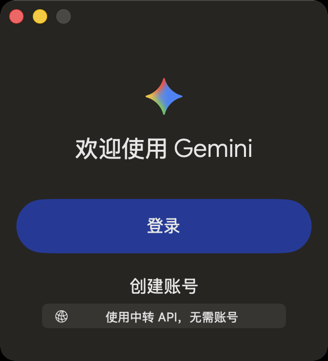

# 安装与首次使用 / Installation and first use

## 中文

1. 确认电脑为 Apple Silicon Mac，系统为 macOS 15 或更新版本。
2. 从 [Releases](https://github.com/TGmszrcsz/gemini-relay/releases/tag/v2026.10.15) 下载 `Gemini-Relay-2026.10.15-arm64.dmg`。
3. 打开 DMG，将 Gemini 拖到 Applications；替换同名应用前请先退出并备份。
4. 若系统阻止启动，在确认来源后通过“系统设置 → 隐私与安全性 → 仍要打开”启动。本包为 ad-hoc 签名，未公证。
5. 填写自己的 API URL 与 Key，点击“验证连接”，查看模型后点击“保存并连接”。无需 Google 账号。
6. 服务必须提供 Gemini 原生生成接口 `/v1beta/models/...:streamGenerateContent` 与 `/v1/models`，具体模型及费用由服务商决定。
7. 从对话区域创建或打开项目，拖入文件，描述需要完成的修改。代码按钮可打开文件树与编辑器。
8. 菜单“MCP 连接”支持 stdio 和 Streamable HTTP，填写自己的 `mcpServers` JSON 后保存并连接。

普通聊天无需 Node.js；本地 MCP 服务所需环境请自行安装。图片与视频生成当前不可用。

安装包不含打包者的 API、历史、项目路径或 MCP 设置。升级不会清空使用者本人的已有配置。

## English

1. Use an Apple Silicon Mac running macOS 15 or later.
2. Download `Gemini-Relay-2026.10.15-arm64.dmg` from [Releases](https://github.com/TGmszrcsz/gemini-relay/releases/tag/v2026.10.15).
3. Open it and drag Gemini into Applications. Quit and back up an existing app before replacing it.
4. If macOS blocks it, verify the source and use System Settings → Privacy & Security → Open Anyway. This build is ad-hoc signed and not notarized.
5. Enter your own API URL and key, choose Verify connection, inspect the model list, then Save and connect. No Google account is required.
6. Your provider must offer Gemini's native `/v1beta/models/...:streamGenerateContent` endpoint and `/v1/models`. Model availability and billing are determined by your provider.
7. Create or open a project in the chat area, drop in files, and describe the changes you want. The code button opens the file tree and editor.
8. MCP connections in the menu supports stdio and Streamable HTTP. Enter your own `mcpServers` JSON and save to connect.

Chat requires no Node.js. Install any runtime required by your local MCP servers separately. Image and video generation are currently unavailable.

The installer includes none of the packager's API settings, history, project paths or MCP configuration. Upgrading preserves the user's existing configuration.

## Verify the download / 校验下载

Place the DMG and the `.sha256` file in the same folder, then run: / 将 DMG 和 `.sha256` 放在同一目录后运行：

```sh
shasum -a 256 -c Gemini-Relay-2026.10.15-arm64.sha256
```

Expected result / 预期结果：`Gemini-Relay-2026.10.15-arm64.dmg: OK`

## API entry / API 入口

The app also retains an API entry on its account page. / 账号页也保留“使用中转 API，无需账号”入口。



[中文首页](../README.md) · [English home](../README.en.md)
